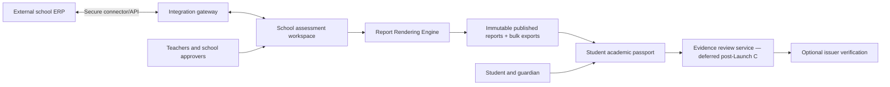

# Software Requirements Specification (SRS)
## School Assessment SaaS & Lifelong Academic Passport

**Document ID:** SRS-001  
**Version:** 1.1  
**Date:** 31 October 2026  
**Status:** Architecture finalised. Engineering baseline for implementation. Legal, academic-board and commercial validations outstanding.  
**Source of truth:** Master Product Blueprint v1.2  
**Related documents:** ADR v1.0 · Implementation Backlog v1.1  
**Product name:** Working title — Assessment & Academic Passport

---

## Change Log

| Version | Date | Summary |
|---|---|---|
| 1.0 | 31 Oct 2026 | Initial SRS |
| 1.1 | 31 Oct 2026 | Technology stack finalised (references ADR v1.0). AUTH-002 expanded for school context switching. ASM-004 expanded into detailed marks-grid UX requirements (ASM-004a–ASM-004j). TPL-004 updated with print layout and bilingual constraints. New §6A Report Rendering Engine (REP-001 to REP-014). New §6B Bulk Export (EXP-001 to EXP-008). LOC-002 updated for Telugu+English bilingual. New AUTH-007 for school context switcher. §21 pending decisions updated. |

---

# 1. Purpose, Scope and Conventions

This SRS translates the product blueprint into **testable system behaviours**. It covers the full product vision, with explicit launch boundaries and phased delivery. All requirement IDs are stable and are cross-referenced by the Implementation Backlog.

**Priority definitions:** `P0` essential for first paid school release (Launch A); `P1` full school platform or student continuity (Launch B/C); `P2` higher education/verification/international expansion (Launch D+). `MUST` = release-blocking within its phase; `SHOULD` = preferred but may be deferred with product approval.

**Critical product boundary:** This is **not an ERP**. ERP APIs are integration sources/targets only. Do not implement fee collection, payroll, hostel, transport, inventory, admissions CRM, library, general timetable or university institutional analytics.

**Stakeholder groups:** Platform operations, school admin, principal/authorised approver, class teacher, subject teacher, student, guardian, verification reviewer, external ERP administrator.

---

# 2. System Overview and Deployment Model

The product has two distinct yet interoperable domains:

1. **Institutional School Workspace (B2B):** Authoritative assessment configuration, gradebooks, stage-specific HPC, growth interventions and published school reports.
2. **Personal Academic Passport (B2C):** A persistent identity with access to eligible school-published copies, personal assessments, higher-education programmes and evidence-review services.

School memberships and student enrolments are **time-bounded relationships**, not identity ownership. A student may belong to multiple school histories and one personal workspace. All cross-domain sharing requires explicit grants and provenance.

**Finalised technology stack (see ADR v1.0 for all rationale and review triggers):**

| Layer | Decision |
|---|---|
| Frontend | Next.js, React, TypeScript, Tailwind CSS, shadcn/ui |
| Backend | NestJS modular monolith (TypeScript) — ADR-001 |
| Database | PostgreSQL with `tenant_id` + RLS isolation — ADR-003 |
| ORM | Prisma (1-week validation before Phase 1) — ADR-002 |
| PDF engine | React SSR + Puppeteer/Chromium — ADR-004 |
| Background jobs | Redis + BullMQ |
| Object storage | S3-compatible, private buckets |
| API | REST + OpenAPI |
| Auth | JWT + bcrypt + TOTP MFA — ADR-006 |
| Search | PostgreSQL full-text initially — ADR-005 |

## 2.1 Context Diagram

---

# 3. Roles and Access Matrix

| Capability | School admin | Principal/approver | Subject teacher | Class teacher | Student | Guardian | Reviewer |
|---|---|---|---|---|---|---|---|
| Configure school, year, directory | Yes | Configurable | No | No | No | No | No |
| Configure official grading/templates | Draft/manage | Approve | No | Propose only | No | No | No |
| Create classroom assessments | Configurable | Configurable | Assigned classes | Assigned classes | Personal only | No | No |
| Enter school marks | Configurable | Configurable | Assigned subjects | Policy-defined | No | No | No |
| Approve/publish official school reports | No by default | Yes | No | Review only | No | No | No |
| Bulk export reports | Yes | Yes | No | Own class only | No | No | No |
| View published reports | School scope | School scope | Assigned scope | Assigned scope | Own | Linked child | No |
| Switch active school context | Yes (multi-school) | Yes (multi-school) | Yes (multi-school) | Yes (multi-school) | N/A | N/A | No |
| Manage personal programmes/results | No | No | No | No | Own | Age-dependent | No |
| Verify evidence | No | No | No | No | Request only | Request for minor | Assigned queue only |

**AUTH-001 (P0, MUST):** Deny access by default; evaluate role, school membership, class/subject assignment, enrolment, relationship and object-specific grant on every request. No implicit cross-tenant access.

**AUTH-002 (P0, MUST):** Users with roles in multiple schools must explicitly switch their active school context. All actions are scoped to the active context. JWT payload includes `active_school_id`; switching context requires a new token via `POST /v1/auth/context-switch`.

**AUTH-003 (P0, MUST):** Sensitive data reads and all changes to marks, templates, approvals, reports, consent and verification must generate audit events with: actor, target object, action, before/after values or reference, timestamp and correlation ID.

**AUTH-004 (P1, MUST):** Guardian relationships require verification and age-appropriate access; guardian revocation and adulthood transition supported.

**AUTH-005 (P2, MUST):** Verification reviewers receive time-bounded, minimum-necessary access; cannot alter student marks or issuer records.

**AUTH-006 (P0, MUST):** TOTP MFA enforced at login for School Admin, Principal/Approver, Platform Superadmin and Verification Reviewer roles.

**AUTH-007 (P0, MUST):** A School Context Switcher screen allows users with multiple school roles to see all authorised schools and select the active one. The switch generates a new scoped JWT. All subsequent requests use the new active school context. The previous context's unsaved state (e.g., marks in progress) must be warned before switching.

---

# 4. Institutional Onboarding and Directory

**TEN-001 (P0):** Platform operations can provision, suspend, reactivate and offboard a tenant without cross-tenant data access.

**TEN-002 (P0):** School admin can configure legal/display name, campuses, logo, address, board, country/state, academic year, timezone, locale and contact details.

**TEN-003 (P0):** School can configure grades from pre-primary through Class 12, sections, subjects, class teachers and subject assignments.

**TEN-004 (P0):** XLSX/CSV import must provide downloadable template, column mapping, preview, row validation, duplicate identification, dry-run and error export.

**TEN-005 (P0):** Import commit must be atomic per validated batch or report per-row successes/failures explicitly; idempotency prevents duplicate enrolments on retry.

**TEN-006 (P0):** A student has a platform identity and one or more school enrolments; institutional identifiers are scoped to a school.

**TEN-007 (P0):** School can deactivate enrolment without deleting historical published records or the personal identity.

**TEN-008 (P1):** Historical academic data imported from legacy sources must be labelled as imported and not automatically platform-issued.

**TEN-009 (P0):** Roster, assignment and academic-year changes must be audit-logged with actor and timestamp.

**Acceptance example:** Given an import with 97 valid, 2 duplicate and 1 invalid row, preview identifies each exception; committed count matches declared policy; re-running the same batch creates no duplicates.

---

# 5. Assessment Creation, Marks and Grading

**ASM-001 (P0):** Assigned teachers can create draft assessments for authorised class/section/subject, title, type, period, date, maximum marks and components.

**ASM-002 (P0):** Assessment types are school-configurable labels (unit, weekly, FA/SA, practical, project, etc.), never hard-coded as universal board requirements.

**ASM-003 (P0):** Assessments can target one or more eligible sections and include component weights, optional competencies and evidence.

**ASM-004 (P0) — Marks-Entry Grid (Excel-like UX):** The marks grid is the primary teacher interface. It must require zero training for a teacher familiar with spreadsheets.

**ASM-004a (P0, MUST):** Grid layout — frozen left columns (roll number, student name); horizontal scroll to component columns; virtualised rows for 50+ students; row-level save status indicator.

**ASM-004b (P0, MUST):** Keyboard navigation — Tab moves right (wraps to next row); Shift+Tab moves left; Enter moves down; Shift+Enter moves up; Arrow keys navigate; Escape discards in-progress cell edit; Delete/Backspace clears to blank (not zero).

**ASM-004c (P0, MUST):** In-range validation — maximum marks displayed in column header; values outside `0..maximum` shown with red border inline; save blocked until all visible errors resolved; configured decimal precision enforced.

**ASM-004d (P0, MUST):** Status codes — each cell supports Absent, Exempt, Incomplete, Withheld as explicit non-numeric states; blank cell means "not yet entered", never silently zero. Status accessible via dropdown or configurable keyboard shorthand.

**ASM-004e (P0, MUST):** Clipboard paste — Ctrl+V / Cmd+V pastes tab-separated clipboard values (from Excel/Google Sheets) into the selected range; row/column count validated before applying; paste preview modal shows mismatches; successful paste enters unsaved state.

**ASM-004f (P0, MUST):** Autosave — cell-level autosave triggers 1.5 seconds after the last keystroke; per-row save status: grey (unmodified), yellow (unsaved), blue (saving), green (saved), red (error). Bulk "Save all" button always available.

**ASM-004g (P0, MUST):** Optimistic concurrency — every `assessment_result` row has a `version` integer; draft PUT includes `If-Match: {version}` header; server returns 409 on stale version; teacher is shown both values and chooses to keep or accept; no silent overwrite.

**ASM-004h (P0, MUST):** Low-bandwidth recovery — unsaved values written to IndexedDB in real-time; on reconnection, pending queue replayed in order; on page reload with pending IndexedDB data, a recovery banner asks the teacher to confirm before restoring; deduplication key prevents duplicate submissions.

**ASM-004i (P0, MUST):** Locking — once assessment is `SUBMITTED` or `LOCKED`, all cells become read-only with a visible lock indicator; re-opening requires an authorised rollback action.

**ASM-004j (P0, MUST):** Scope enforcement — teacher sees only students in their assigned class/subject; attempting to access an out-of-scope assessment returns 403.

**ASM-005 (P0):** Each result has explicit state: scored, absent, exempt, incomplete or withheld; blank is not silently zero.

**ASM-006 (P0):** A scored result outside `0..maximum` must be rejected; decimals allowed only under configured precision.

**ASM-007 (P0):** Results import supports CSV/XLSX validation and duplicate/missing student reconciliation.

**ASM-008 (P0):** Draft edits preserve revision history (old/new values, actor, reason when required).

**ASM-009 (P0):** School-configured grading policies support numeric scales, letter grades, configurable weights, rounding and exemption treatment; version each policy.

**ASM-010 (P0):** Calculation engine stores input references, policy version, calculated values, rounding mode and warnings; results reproducible from stored snapshot.

**ASM-011 (P0):** Assessment lifecycle: `DRAFT → OPEN → RESULTS_IN_PROGRESS → SUBMITTED → VERIFIED → LOCKED`; authorised rollback allowed only before report publication with audit.

**ASM-012 (P0):** Classroom test reports may be generated by teachers without granting official annual-report publication rights.

**ASM-013 (P0):** Teacher sees only assigned class/subject results; class teacher gets school-approved consolidated view.

**ASM-014 (P1):** Rubric/qualitative assessment values are stored independently; no automatic conversion to percentage.

**ASM-015 (P1):** Assessment trends distinguish changing maximum marks, absences and different grading scales.

**Calculation rule:** For numeric component `i`, normalise as `score_i / maximum_i`, then aggregate according to the versioned policy; do not include exempt/missing items unless the policy explicitly defines the treatment. The report snapshot must contain the precise policy used.

**Edge cases:** student transfers mid-term; late enrolment; subject change; absent examination; re-test; practical vs theory; marks submitted after deadline; teacher reassignment; conflicting ERP data; class with zero students; 0 maximum marks (invalid).

---

# 6. Official Report Card Studio

**TPL-001 (P0):** Admin can create draft templates from a template library filtered by board, grade, academic year, assessment type and status.

**TPL-002 (P0):** Visual builder supports ordered components: school branding, student details, marks table, grades, attendance summary, teacher comments, legend, signatures, QR verification, footer, bilingual field pairs.

**TPL-003 (P0):** Components have configurable properties, visibility rules and typed data bindings; unknown/unavailable bindings fail validation before publication.

**TPL-004 (P0):** Builder supports A4 printing and multipage layouts. **Print layout requirements (mandatory for all PDF renders):**
- Page size: A4 (210 × 297mm); page margins: top 12mm, right 10mm, bottom 18mm, left 10mm.
- `printBackground: true` required in Puppeteer configuration.
- Footer signature/stamp block: minimum 28mm reserved on the last page, white background, no content.
- Fonts embedded via base64 `@font-face`: Noto Sans (English), Noto Sans Telugu (Telugu bilingual). Never load fonts from CDN during render.
- No `vh`, `vw`, `position: fixed`, or scroll-dependent CSS in report component styles.
- Charts: inline SVG with explicit `width` and `height` attributes.
- Student names up to 80 characters and subject names up to 60 characters must not break layout.
- Page breaks controlled via `page-break-before: always` on section containers.

**TPL-005 (P0):** Templates are versioned; approved versions are immutable; changes require a new draft version.

**TPL-006 (P0):** Only authorised approver can approve an official template version.

**TPL-007 (P0):** A school can bind a template version and grading-policy version to a grade/period/report definition.

**TPL-008 (P0):** Preview uses synthetic or permission-authorised student data and flags missing data/overflow.

**TPL-009 (P1):** Stage-specific HPC and portfolio components available only when relevant framework data exists.

**TPL-010 (P1):** Bilingual field pairs (English + regional language) configurable per component; additional language packs added via board/country pack registry.

**TPL-011 (P0):** Teacher-customised classroom report layouts must not modify school-approved official templates.

---

# 6A. Report Rendering Engine

The Report Rendering Engine is the backend service that produces PDF artifacts from template definitions and data snapshots. It is shared by all report types. See §12B of the Blueprint and ADR-004 for the full pipeline architecture.

**REP-001 (P0, MUST):** The engine accepts a template JSON definition and a set of validated data-binding references. All bindings must be verified against the current assessment snapshot before committing. An unknown or unauthorised binding must fail with an actionable error before any PDF is generated.

**REP-002 (P0, MUST):** Before PDF generation begins, the engine commits an immutable `report_snapshot` record containing: `template_version_id`, `policy_version_id`, `student_id`, `school_id`, `academic_year_id`, `period_id`, `data_snapshot` (JSON of all bound values at time of generation), `schema_version` and `created_at`. The PDF is reproducible from this snapshot at any future date.

**REP-003 (P0, MUST):** The engine renders the React report component tree server-side using `renderToStaticMarkup`, injects the output into an HTML shell with embedded fonts and `@page` print rules, then invokes Puppeteer with `printBackground: true` and the A4 margin configuration defined in ADR-004. No external network requests are permitted during rendering.

**REP-004 (P0, MUST):** After PDF generation, the engine computes a SHA-256 hash of the PDF bytes and uploads the file to S3 under a private path. The `report_artifact` record stores: `s3_key`, `sha256_hash`, `size_bytes`, `generated_at` and `puppeteer_version`. The PDF bytes are never stored in the database.

**REP-005 (P0, MUST):** All PDF generation runs as a BullMQ background job. No PDF is generated synchronously on an API request. The API returns a `job_id`; the client polls or subscribes to a Server-Sent Events stream for status.

**REP-006 (P0, MUST):** PDF generation jobs are idempotent. Retrying a failed job with the same `report_snapshot_id` must not produce a duplicate `report_artifact`. Duplicate detection is via `(report_snapshot_id, generation_attempt)` key.

**REP-007 (P0, MUST):** Bilingual content: when the tenant's country pack or template configuration includes a secondary language (`te` for Telugu, or future packs), the HTML shell includes the appropriate embedded font and component cells render English + secondary language field pairs as configured in the template.

**REP-008 (P0, MUST):** The engine supports all report types: classroom test report, subject progress report, FA/SA summary, term/annual report card, HPC report, personal academic report and bulk export. The same Puppeteer pipeline is used for all.

**REP-009 (P0, MUST):** Visual regression tests: a golden PDF fixture is stored per report type and board configuration. Each CI build regenerates the fixture and compares PNG snapshots page by page using pixelmatch. The pixel-difference threshold is < 0.1% of total pixels per page (excluding dynamic date fields). A failing visual regression test blocks the build.

**REP-010 (P0, MUST):** Presigned download URLs have a 15-minute expiry. Long-lived access to published reports is through the student/admin portal UI, not through permanent public URLs.

**REP-011 (P1, MUST):** The engine supports chart components rendered as inline SVGs using server-side chart library output. No canvas-based charts in report templates.

**REP-012 (P0, MUST):** Puppeteer instance management: a process pool must be used to prevent memory leaks and control concurrency. Maximum concurrent Puppeteer instances per pod must be configurable. Pod memory limit must account for Chromium heap usage.

**REP-013 (P0, MUST):** Fonts are embedded as base64 `@font-face` data URIs in the HTML shell. The font embedding is part of the HTML shell template, not the report component. Font files are loaded from the local filesystem at server startup and cached in memory.

**REP-014 (P0, SHOULD):** A synthetic preview endpoint generates a PDF from a template with anonymised/placeholder data without committing a `report_snapshot`. Used by the Report Card Studio preview function. Real student data is never used in synthetic preview.

---

# 6B. Bulk Export

**EXP-001 (P0, MUST):** School admin and authorised staff can create a bulk export job scoped to: academic year, report type, and one or more of — grade, section, or selected individual students. The export scope must be validated against the requesting user's permissions before the job is enqueued.

**EXP-002 (P0, MUST):** A bulk export job enqueues one BullMQ sub-job per section (not per student). Each sub-job generates individual student PDFs and assembles them into a section ZIP archive. Section ZIPs are then assembled into a final export ZIP named: `{school_short_name}_{grade}_{section}_{exam}_{YYYY-MM-DD}.zip`.

**EXP-003 (P0, MUST):** Export progress is streamed to the requesting browser via a Server-Sent Events endpoint (`GET /v1/bulk-exports/{id}/status`). The SSE stream reports: total student count, completed count, failed count, current status (`QUEUED`, `IN_PROGRESS`, `ASSEMBLING`, `COMPLETED`, `PARTIAL_FAILURE`, `FAILED`).

**EXP-004 (P0, MUST):** On completion, the ZIP is stored in S3 private storage. The export record stores: `s3_key`, `sha256_hash`, `size_bytes`, `completed_at`, `total_count`, `success_count`, `failure_count`. A download link (presigned URL, 48-hour expiry) is made available in the Bulk Export Centre.

**EXP-005 (P0, MUST):** Partial failure handling: if individual student PDFs fail, the export continues for remaining students. The final ZIP includes: all successful PDFs, and a `manifest.json` listing every student's export status (success, failure reason, report ID or null). The admin can see and re-trigger individual failed PDFs from the Bulk Export Centre.

**EXP-006 (P0, MUST):** A bulk export job may only be created for report types that have reached `PUBLISHED` status. Attempting to export unpublished or draft reports returns a validation error.

**EXP-007 (P0, MUST):** Bulk export jobs are scoped to the requesting user's tenant. Cross-tenant export attempts return 403. The ZIP content must never include reports from another tenant.

**EXP-008 (P1, SHOULD):** Bulk export history is retained for 30 days in the Bulk Export Centre. Admins can re-download previous exports if the S3 link has not expired, or re-trigger a new export. Expired ZIPs are cleaned up by a scheduled S3 lifecycle policy.

---

# 7. Report Approval, Publication and Corrections

**PUB-001 (P0):** Generate report drafts from a frozen assessment result set and explicit template/policy versions.

**PUB-002 (P0):** Validate report readiness: required subjects, unresolved results, required remarks, approval authority and template status.

**PUB-003 (P0):** School can configure class-teacher review before principal/authorised final approval.

**PUB-004 (P0):** Publish operation creates a **new immutable report snapshot** with unique ID, issuer, student, period, template version, policy version, timestamp, content hash and PDF artifact.

**PUB-005 (P0):** No API, admin UI, background job or database update path may modify published report payload/PDF in place.

**PUB-006 (P0):** A correction creates a new approval workflow and a new published record linked by `supersedes_report_id`; old content remains unchanged while lawfully retained.

**PUB-007 (P0):** Verification page identifies report existence, issuing institution, publication time, status and supersession without exposing private marks to unauthorised viewers.

**PUB-008 (P0):** Student/guardian may view and download eligible published PDFs subject to consent, enrolment and access policy.

**PUB-009 (P0):** Failed PDF jobs retry safely; publishing must be idempotent and cannot issue duplicate report IDs on repeated requests.

**PUB-010 (P1):** Batch publish supports partial failure report and resumable generation.

**PUB-011 (P0):** Published school records may be erased where legally required under a controlled retention/erasure workflow; immutability is not indefinite retention.

**Publication state:** `REPORT_DRAFT → REVIEW_PENDING → APPROVED → PUBLISHING → PUBLISHED`; correction: `CORRECTION_REQUESTED → CORRECTION_APPROVED → NEW_PUBLISHED_VERSION`. Published artifacts are immutable; a separate status pointer indicates supersession.

**Acceptance example:** Given report R1 published with 86/100, an attempted direct update to 88/100 returns 409/403 and is logged. A school-authorised correction produces R2 with 88/100, links to R1, and the verification page marks R1 superseded.

---

# 8. Holistic Progress Card and Growth Portfolio

**HPC-001 (P1):** Framework packs are versioned by jurisdiction, board, grade/stage and academic year.

**HPC-002 (P1):** Competency observations store descriptor/rubric, date, observer, evidence and visibility.

**HPC-003 (P1):** Support stage-appropriate teacher, student, peer and guardian contributions where configured and lawful.

**HPC-004 (P1):** School-approved HPC is published as immutable official record with source evidence references.

**HPC-005 (P1):** Personal accounts cannot self-issue a school-certified HPC.

**GRW-001 (P1):** Growth case workflow: observed → baseline → action planned → active → reviewed → improved/continuing/escalated → closed/reopened.

**GRW-002 (P1):** Each case records objective, evidence, intervention, owner, review date, outcome and audit history.

**GRW-003 (P1):** Sensitive internal notes are separated from student-shareable portfolio items by field-level policy.

**GRW-004 (P1):** Analytics include competency coverage, longitudinal progress, intervention outcomes and data completeness; no automated medical or psychological diagnosis.

**GRW-005 (P1):** Optional AI suggestions require human review and cannot autonomously change marks, publish reports or make diagnoses.

---

# 9. Academic Passport, Transfers and Higher Education

**PAS-001 (P1):** Passport identity persists independently of school subscriptions/enrolments.

**PAS-002 (P1):** Eligible published school reports appear read-only with issuer, publication date, supersession and download.

**PAS-003 (P1):** Passport offers PDF downloads and export ZIP with JSON/CSV metadata and SHA-256 manifest, subject to access/retention.

**PAS-004 (P1):** School departure terminates active school permissions without deleting eligible portable reports.

**PAS-005 (P1):** Prior-school sensitive records are not shared with a new school by default; user/guardian grants are explicit and revocable where applicable.

**PAS-006 (P1):** Student can create personal subjects, assessments, results and personal report PDFs visibly marked `Self-reported — not institution-certified`.

**PAS-007 (P1):** Personal report may show a student-entered institution as contextual text but must not imitate official seals, signatures or verified status.

**PAS-008 (P1):** Personal reports can be finalised as immutable snapshots and superseded by later personal versions.

**PAS-009 (P2):** Student can define undergraduate/postgraduate/research programmes with flexible semester/term/year structure.

**PAS-010 (P2):** Programme supports subjects, credits, assessment attempts, marks, grade points, CGPA/SGPA and custom grade scales without unapproved conversions.

**PAS-011 (P2):** Supporting evidence files can be attached with clear uploader/source metadata.

**PAS-012 (P1):** Account lifecycle includes secure recovery, guardian controls, adulthood transition and school-transfer identity matching.

---

# 10. Human Evidence Review and Verification

> **Status: Deferred to post-Launch C.** These requirements are defined for completeness and long-term roadmap planning. No engineering work on EP10 begins until the core school platform and Academic Passport are validated.

**VER-001 (P2):** Student submits a claim with structured fields and supporting document; system validates file format/size and scans uploads for malware.

**VER-002 (P2):** Fee, scope and expected turnaround are shown before payment; payment buys a review, not a successful badge.

**VER-003 (P2):** Review queue assigns cases to authorised staff, with minimum-necessary access and audit.

**VER-004 (P2):** Reviewer can decide `DOCUMENT_MATCHED`, `MISMATCH`, `INCONCLUSIVE` or `MORE_EVIDENCE_REQUIRED`; cannot edit claimed marks.

**VER-005 (P2):** `DOCUMENT_MATCHED` means entered data matches uploaded document **only**; it does not prove issuer authenticity.

**VER-006 (P2):** `ISSUER_VERIFIED` requires documented confirmation from an authorised issuer-controlled source or trusted authorised integration.

**VER-007 (P2):** `PLATFORM_ISSUED` applies only to a report published by an authorised institutional workspace.

**VER-008 (P2):** Verification decision is versioned, attributable, appealable and revocable/supersedable through new audit events.

**VER-009 (P2):** Public verification displays precise level, scope, timestamp and status with minimal personal information.

**VER-010 (P2):** Reviewer performance and false-positive monitoring supports secondary quality checks.

---

# 11. External ERP Integration (Integration Only)

**INT-001 (P0):** Manual entry and CSV/XLSX import remain available without ERP integration.

**INT-002 (P1):** Generic authenticated REST integration endpoints support student, enrolment, class, section, subject, teacher and assignment synchronisation.

**INT-003 (P1):** Integration connector stores per-tenant field mapping, external IDs, source system, last sync cursor, schedule and error history.

**INT-004 (P1):** Sync supports initial full import plus incremental upsert with idempotency, pagination, retries, rate limits and conflict reporting.

**INT-005 (P1):** School chooses authoritative source per field/data domain; conflicts do not silently overwrite manually approved changes.

**INT-006 (P1):** Optional ERP→SaaS attendance summary and assessment marks imports require explicit scope and validation.

**INT-007 (P1):** Optional SaaS→ERP export of published report metadata/PDF links/approved marks only when destination API and school authorisation permit.

**INT-008 (P1):** Sync must never overwrite immutable published reports; new ERP data affects only future drafts or authorised corrections.

**INT-009 (P1):** Secrets stored encrypted in managed secret storage; use least-privilege credentials, TLS, rotation and webhook signature validation.

**INT-010 (P1):** Integration health dashboard shows last success, failed records, retries, mappings, manual re-sync and audit.

**INT-011 (P2):** Vendor-specific connectors are prioritised by pilot-school demand; do not claim universal plug-and-play compatibility.

---

# 12. Country and Board Configuration

**LOC-001 (P0):** Country/board/year/class rules stored as versioned data/configuration, not hard-coded constants.

**LOC-002 (P0):** Board packs include terminology, subjects, assessment/grading patterns, required report fields, supported grades, effective dates, and **bilingual field definitions** (English primary + regional language secondary). For the India pilot, Telugu is the first secondary language. The pack includes: the Telugu font pack reference, bilingual subject name mappings for common subjects, and grade descriptor translations. Additional language packs (Hindi, Kannada, Tamil, etc.) are added via the pack registry.

**LOC-003 (P1):** Localisation supports Unicode, date/number conventions, timezone, language and A4/Letter formats.

**LOC-004 (P2):** International tenant onboarding is gated on validated local privacy, contract, residency and academic requirements.

**LOC-005 (P2):** UAE discovery/pilots precede other international institutional launches; country-specific compliance claims require independent review.

---

# 13. Privacy, Retention and Security

**SEC-001 (P0):** TLS in transit; encryption at rest for database, backups and object storage; secret manager for credentials.

**SEC-002 (P0):** Object storage private by default, short-lived signed URLs (15-minute expiry for report PDFs), file validation, malware scan and access logging.

**SEC-003 (P0):** TOTP MFA required for privileged school, platform and reviewer roles; secure session management with rotating refresh tokens.

**SEC-004 (P0):** Tenant-isolation automated tests at API, query and storage layers; RLS policies tested with explicit cross-tenant fuzz tests.

**SEC-005 (P0):** Append-only audit trail for high-risk actions with actor, target, action, timestamp, reason and correlation ID.

**SEC-006 (P0):** Daily automated backups, restore drills, defined recovery objectives and incident response runbook before paid launch.

**SEC-007 (P1):** Consent records are purpose-specific and revocable where applicable; age/guardian rules jurisdiction-dependent.

**SEC-008 (P1):** Data export, correction, erasure requests and legal holds have auditable case workflows.

**SEC-009 (P1):** Five-year inactivity **review** is a proposed policy, not a universal statutory retention duration or automatic deletion rule.

**SEC-010 (P1):** Separate retention schedules for published school records, personal records, unpublished notes, verification uploads, audit logs and billing.

**SEC-011 (P0):** No advertising-driven profiling or sale of children's academic data.

**SEC-012 (P1):** Cross-border processing, child data, legal bases and school–processor contracts require local legal sign-off before production use.

**SEC-013 (P0):** Rate limiting, input validation, secure headers, dependency scanning, threat modelling and penetration testing prior to general release.

---

# 14. Non-Functional Requirements and Service Targets

| ID | Target | Validation |
|---|---|---|
| NFR-001 | 99.5% monthly uptime target during paid beta, excluding announced maintenance | Monitoring and incident reports |
| NFR-002 | p95 interactive read API < 500ms under agreed pilot load, excluding PDF/export jobs | Load test |
| NFR-003 | p95 marks save response < 1s for 50 concurrent teachers per tenant | Load test |
| NFR-004 | 1,000 student PDFs queued and generated reliably within pilot-agreed batch window (initial target: 30 minutes) | Batch test and metrics |
| NFR-005 | Import 5,000 student rows with row-level errors and idempotency | Integration test |
| NFR-006 | No critical/high severity unresolved security vulnerabilities at paid launch | Security gate |
| NFR-007 | Keyboard-accessible core workflows; WCAG 2.2 AA as design target | Accessibility audit |
| NFR-008 | RPO ≤ 24 hours and RTO ≤ 8 hours for paid beta; improve with scale | Restore exercise |
| NFR-009 | All publication and verification events traceable by correlation ID | Audit tests |
| NFR-010 | Graceful degradation if ERP or verification provider unavailable | Chaos/integration test |
| NFR-011 | Single PDF generation p95 < 8 seconds; class of 50 PDFs complete within 3 minutes | Performance test |
| NFR-012 | Bulk export of 1,000 students generates complete ZIP within 30 minutes | Batch test |
| NFR-013 | Visual regression tests: PDF fixtures match < 0.1% pixel difference per page in CI | CI regression test |

---

# 15. Reference Data Model

**Institutional:** `organisations`, `schools`, `school_memberships`, `school_context_grants`, `academic_years`, `grades`, `sections`, `subjects`, `teacher_assignments`, `student_identities`, `student_enrolments`.

**Assessment:** `assessment_periods`, `assessments`, `assessment_components`, `assessment_targets`, `assessment_results`, `assessment_result_revisions`, `grading_policies`, `grading_policy_versions`, `competencies`, `assessment_evidence`.

**Reporting:** `report_templates`, `report_template_versions`, `report_definitions`, `report_snapshots`, `report_runs`, `student_reports`, `report_approvals`, `report_publications`, `report_supersessions`, `report_artifacts`, `report_verification_tokens`, `bulk_export_jobs`, `bulk_export_artifacts`.

**Growth:** `frameworks`, `framework_versions`, `competency_assessments`, `portfolio_entries`, `growth_cases`, `growth_observations`, `growth_interventions`, `growth_reviews`.

**Passport:** `personal_workspaces`, `guardian_relationships`, `record_access_grants`, `portable_report_copies`, `personal_assessments`, `personal_results`, `education_programmes`, `programme_terms`, `personal_subjects`, `grade_scales`, `personal_projects`.

**Verification/compliance (deferred):** `verification_requests`, `verification_evidence`, `verification_reviews`, `verification_decisions`, `issuer_confirmations`, `consent_records`, `retention_policies`, `export_jobs`, `deletion_requests`, `audit_events`, `payments`.

**Integration:** `erp_connections`, `integration_credentials_ref`, `integration_field_mappings`, `external_entity_links`, `sync_runs`, `sync_cursors`, `sync_conflicts`, `outbound_events`.

### Domain invariants

- All institutional records have `school_id` (= `tenant_id`) and explicit tenant scope.
- `tenant_id` is indexed on every tenant-scoped table; RLS policy references `app.current_tenant_id` session variable.
- All external references have `(school_id, provider, external_id)` unique constraints where applicable.
- Published report body/artifact never updated in place.
- `report_snapshot` is committed before PDF generation begins; PDF is derived from snapshot, not the other way around.
- Official and self-reported records are separate types, never inferred from display labels.
- Personal access grants do not imply institutional editing rights.
- Student transfer never rewrites prior issuer attribution.

---

# 16. API Contract Outline

| Method | Path | Action |
|---|---|---|
| POST | `/v1/auth/login` | Authenticate; return JWT + refresh token |
| POST | `/v1/auth/context-switch` | Switch active school; return scoped JWT |
| POST | `/v1/schools/{schoolId}/students/imports/preview` | Validate roster |
| POST | `/v1/schools/{schoolId}/students/imports/{jobId}/commit` | Commit roster |
| POST | `/v1/assessments` | Create assessment |
| PUT | `/v1/assessments/{id}/results/draft` | Save marks with `If-Match` concurrency token |
| POST | `/v1/assessments/{id}/submit` | Submit marks |
| POST | `/v1/assessments/{id}/lock` | Lock approved results |
| POST | `/v1/report-templates` | Create template draft |
| POST | `/v1/report-templates/{id}/versions/{version}/approve` | Approve template |
| POST | `/v1/report-runs` | Generate report batch (enqueues BullMQ job) |
| GET | `/v1/report-runs/{id}/status` | SSE stream of generation progress |
| POST | `/v1/student-reports/{id}/publish` | Immutable publication |
| POST | `/v1/student-reports/{id}/corrections` | New supersession workflow |
| POST | `/v1/bulk-exports` | Create bulk export job |
| GET | `/v1/bulk-exports/{id}/status` | SSE stream of export progress |
| GET | `/v1/bulk-exports/{id}/download` | Signed ZIP download URL |
| GET | `/v1/verify/{token}` | Minimal report authenticity status |
| GET | `/v1/passport/reports` | Eligible published reports |
| POST | `/v1/passport/exports` | Export bundle |
| POST | `/v1/passport/programmes` | Higher-education programme |
| POST | `/v1/verifications` | Paid evidence review request (deferred) |
| POST | `/v1/verifications/{id}/decisions` | Reviewer decision (deferred) |
| POST | `/v1/integrations/erp/connections` | Configure ERP connection |
| POST | `/v1/integrations/erp/{id}/sync` | Queue synchronisation |
| GET | `/v1/integrations/erp/{id}/runs` | Sync audit and errors |

API definitions must specify request/response JSON schemas, auth scopes, errors (400/401/403/404/409/422/429), pagination, idempotency keys and concurrency tokens before coding. OpenAPI is the contract source of truth, auto-generated via `@nestjs/swagger`.

---

# 17. Screen Inventory and UX Requirements

**Admin:** school setup; directory; import wizard; roles; board pack and grading; assessment calendar; template library; three-pane report builder; preview (bilingual); approvals; published reports; correction centre; **School Context Switcher** (multi-school users); **Bulk Export Centre** (grade/section/exam/student-selection ZIP, progress indicators, re-trigger failed); ERP connections; sync dashboard; audit; billing.

**Teacher:** my classes; assessment wizard; **marks grid** (Excel-like keyboard nav, paste, autosave, concurrency, offline recovery); bulk import; submission status; classroom report; competency rubric; observations; intervention case; class results.

**Principal:** approval queue; template review; report readiness; publish confirmation; corrections; academic insights.

**Student/guardian:** passport timeline; official report viewer; download centre; personal tests; personal report builder; programmes; consent/sharing; verification requests (deferred); account export.

**Reviewer (deferred):** assigned cases; document comparison; decision form; escalations; audit.

UX MUST show provenance and lifecycle status prominently, prevent accidental publication, support bulk workflows, and provide clear error recovery.

---

# 18. End-to-End School Workflow and Acceptance Scenario

**Scenario SRS-E2E-001 — FA1 to official published report**

1. Admin creates a school tenant, academic year, Grade 8A, Mathematics subject, teacher and 40 students.
2. Admin imports student roster and assigns Mathematics teacher.
3. Admin configures FA1 assessment period and grading policy.
4. Teacher creates Mathematics FA1 out of 50, uses marks grid (Tab/Enter nav, paste from clipboard), enters 40 results including an absent student, submits.
5. Authorised reviewer verifies marks and locks the assessment.
6. Admin creates/approves official Grade 8 FA1 report template (with Telugu+English bilingual subject names).
7. Report Rendering Engine commits `report_snapshot`, generates 40 PDFs via React SSR + Puppeteer; visual regression test passes.
8. Readiness validator flags unresolved required data; class teacher reviews; principal approves; publish job produces immutable reports with IDs, PDF hashes and bilingual print-ready output.
9. Admin uses Bulk Export Centre to download all 40 Grade 8A FA1 reports as a ZIP archive.
10. Student/guardian accesses their own report; unrelated student and school receive 403/404.
11. Principal finds an error; correction creates R2, R1 remains unchanged and marked superseded.
12. Student transfers; old school enrolment closes, eligible report copy remains in passport and is downloadable.
13. ERP later sends changed profile data; R1/R2 original publication snapshots do not change.

**E2E release gate:** No unresolved P0 defect, correct report calculations, no unauthorised access, immutability proven via API tests, bilingual PDF quality accepted by pilot school, bulk export ZIP valid and complete.

---

# 19. QA Strategy

- Unit tests: grading, rounding, state machines, permissions and field mappings.
- Property-based tests: marks range, component weights, idempotent imports and report snapshot invariants.
- Integration tests: DB transactions, object storage, job retries, ERP timeouts and payment callbacks.
- E2E browser tests: admin, teacher, principal, student and guardian flows including marks grid keyboard navigation.
- Security tests: IDOR/cross-tenant enumeration, session fixation, file upload abuse, reviewer privilege escalation, RLS bypass attempts.
- Accessibility and print tests: keyboard, screen reader labels, Unicode, bilingual Telugu+English, multipage PDFs, variable content.
- Visual regression tests: PDF golden fixtures, pixelmatch comparison, bilingual layout, print margin validation.
- Performance tests: peak exam week, concurrent saves (NFR-003), batch report generation (NFR-004, NFR-011, NFR-012).
- Operational tests: backup restoration, incident drill, school offboarding, passport export and deletion requests.

---

# 20. Release Gates and Traceability

| Release | Included requirements | Exit criterion |
|---|---|---|
| Launch A — School paid beta | TEN, AUTH P0 (incl. AUTH-007 context switcher), ASM P0 (incl. ASM-004a–j), TPL P0, PUB P0, REP P0, EXP P0, SEC P0, NFR beta targets | Real school completes exam-to-report cycle; bilingual PDF accepted; bulk export working |
| Launch B — Full school | HPC, GRW, richer analytics, ERP generic integration INT-002–010 | Validated frameworks, no duplicate-entry burden |
| Launch C — Student Passport | PAS-001–008, guardian/transfer/export/retention | Transfer and access controls verified; passport validated by pilot students |
| Launch D — Verified Passport | PAS-009–011, VER, payments and reviewer operations | Badge semantics and fraud controls independently tested; only after Launch C validated |
| International pilot | LOC P2 and local legal/academic pack | Jurisdiction-specific sign-off |

**Traceability:** Every backlog item includes requirement IDs. Every P0 requirement must have one or more automated or documented acceptance tests before Launch A.

---

# 21. Assumptions, Decisions Pending and Change Control

- **Technology stack is finalised** — see ADR v1.0. Stack changes require a new ADR superseding the relevant record.
- Pilot schools, board versions, sample reports and institution approval policies must be confirmed before feature freeze.
- Five-year inactivity is a proposed review trigger, not a legally established uniform retention period.
- Document matching is not issuer authentication; paid reviews may be inconclusive.
- India privacy obligations, child data rules, consent, retention and international data transfers need qualified legal review.
- Board-specific report and HPC rules need validation against current official requirements.
- ERP API compatibility depends on each vendor's published or contractually available APIs.
- Infrastructure vendor, payment provider, exact performance SLOs and pricing are pending decisions.
- Changes to this SRS require a numbered revision, impact analysis, changed requirement IDs and backlog reconciliation.

---

*End of SRS v1.1*
