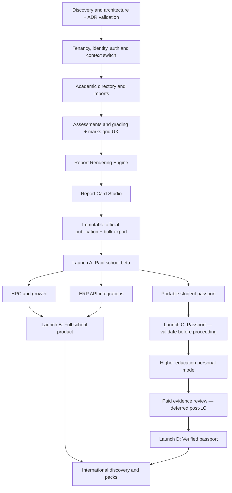

# Engineering Implementation Backlog
## School Assessment SaaS & Lifelong Academic Passport

**Document ID:** BACKLOG-001  
**Version:** 1.1  
**Date:** 31 October 2026  
**Derived from:** Master Product Blueprint v1.2 · SRS v1.1 · ADR v1.0  
**Status:** Proposed delivery backlog; estimates and dependencies require team refinement

---

## Change Log

| Version | Date | Summary |
|---|---|---|
| 1.0 | 31 Oct 2026 | Initial backlog |
| 1.1 | 31 Oct 2026 | Added BL-087 (school context switcher, EP01). Added EP04A Report Rendering Engine (BL-088 to BL-095). Expanded BL-023 marks grid to full Excel-like UX spec. Added BL-096 to BL-099 (bulk export, EP05). EP10 Verification explicitly deferred post-Launch C. Added Prisma validation sprint (BL-004A). Updated dependency map. |

---

## 1. How to Use This Backlog

Each `BL-###` is a deliverable engineering work item grouped into epics and phases. **Dependencies** identify prerequisite backlog IDs. **Done when** is an observable acceptance condition; full test cases must additionally cover the associated SRS IDs.

**Size legend:** S ≈ 1–3 engineering days; M ≈ 3–7; L ≈ 1–2 weeks; XL ≈ 2–4 weeks. Rough single-owner effort bands — not elapsed time or commitments. Split XL items before sprint planning.

**Workflow:** `PROPOSED → REFINED → READY → IN_PROGRESS → CODE_REVIEW → QA → ACCEPTED → RELEASED` (or `BLOCKED`). Do not mark `ACCEPTED` without acceptance evidence and SRS traceability.

**Launch gates:** Launch A = paid school beta (assessment to immutable report, bilingual PDF, bulk export); Launch B = HPC, growth and generic ERP integration; Launch C = portable student passport; Launch D = higher education personal mode and paid evidence review (deferred post-Launch C validation); later = internationalisation.

**ERP boundary:** API integration only. No ERP modules.

---

## 2. Milestone and Dependency Map

---

## 3. Backlog Items

### EP00 — Discovery, Architecture and Design

**Delivery phase:** Phase 0 · **Target gate:** Launch A · **Items:** 7

| ID | Task | SRS trace | Owner | Size | Dependencies |
|---|---|---|---|---|---|
| BL-001 | Confirm pilot schools, board versions, sample report cards, bilingual requirements | `LOC-001,LOC-002` | Product | S | — |
| BL-002 | Map teacher/principal workflows and baseline manual effort | `ASM-001,PUB-003` | Product/UX | M | BL-001 |
| BL-003 | Define privacy, guardian consent and record custody contracts | `SEC-007,SEC-012` | Legal/Security | L | BL-001 |
| BL-004 | Approve modular-monolith architecture and stack ADRs (ADR v1.0) | `SEC-001,NFR-001` | Tech lead | M | BL-001 |
| BL-004A | Prisma technical validation sprint: RLS integration, complex query patterns, migration rollback | `ADR-002` | Backend | S | BL-004 |
| BL-005 | Create design system and clickable school-to-report prototype (includes bilingual PDF mockup) | `TPL-002,ASM-004` | UX | L | BL-002 |
| BL-006 | Set up repositories, CI/CD, coding standards, visual regression test harness | `SEC-013,REP-009` | Platform | M | BL-004 |

**Acceptance / definition of done**

- **BL-001:** 3+ school requirements collected; approved sample reports; board/year matrix; at least one school confirms bilingual (Telugu+English) requirement.
- **BL-002:** Current workflow steps and benchmark time documented for 3 pilot workflows.
- **BL-003:** Counsel-reviewed data flows, school agreements, transfer/access assumptions and open risks documented.
- **BL-004:** Architecture diagrams, tenancy model (ADR-003), all ADRs approved; ADR v1.0 signed off.
- **BL-004A:** Written result: Prisma + RLS works (or superseding ADR if it fails). Go/no-go decision before BL-007.
- **BL-005:** Teacher, admin, principal and student flows validated with pilot users; bilingual report mockup approved.
- **BL-006:** Protected branches, automated lint/typecheck/test/build, pixelmatch PDF regression harness, release process.

---

### EP01 — Identity, Tenancy and Security

**Delivery phase:** Phase 1 · **Target gate:** Launch A · **Items:** 8

| ID | Task | SRS trace | Owner | Size | Dependencies |
|---|---|---|---|---|---|
| BL-007 | Provision school tenants and school profile | `TEN-001,TEN-002,ADR-003` | Backend | L | BL-004A |
| BL-008 | Implement JWT login, rotating refresh tokens, TOTP MFA | `AUTH-001,AUTH-006,SEC-003,ADR-006` | Backend | L | BL-007 |
| BL-009 | Build role and object-level authorisation policies (NestJS guards) | `AUTH-001,AUTH-002,ADR-001` | Backend | XL | BL-008 |
| BL-010 | Create audit event pipeline and immutable change log | `AUTH-003,SEC-005` | Backend | L | BL-009 |
| BL-011 | Implement encryption, secrets, signed file access (15-min presigned URLs) | `SEC-001,SEC-002` | Platform | L | BL-007 |
| BL-012 | Implement rate limits, secure headers and input validation (NestJS pipes) | `SEC-013,ADR-001` | Backend | M | BL-008 |
| BL-013 | Set up backup, restore, monitoring and incident runbooks | `SEC-006,NFR-008` | Platform | L | BL-007 |
| BL-087 | Build school context switcher: multi-school user UX, context-switch token endpoint | `AUTH-002,AUTH-007` | Full stack | M | BL-009 |

**Acceptance / definition of done**

- **BL-007:** Two test schools isolated; branding, locale and academic year configurable. Cross-tenant API tests pass.
- **BL-008:** Secure login/logout, session expiry (15-min access token, 7-day refresh rotate), TOTP MFA enforced for Admin/Principal/Reviewer.
- **BL-009:** Cross-school and unassigned-class access denied via automated fuzz tests. Object-level permission checks confirmed.
- **BL-010:** Sensitive changes log actor, object, before/after or reference, time and correlation ID. Append-only.
- **BL-011:** No public student files; 15-minute presigned URLs; secrets never logged. PDF download verified.
- **BL-012:** Abuse tests reject invalid input and excessive requests. NestJS `ValidationPipe` with whitelist active.
- **BL-013:** Restore drill successful; observable errors and monitoring in place before pilot.
- **BL-087:** Admin with 2 schools sees school-switcher dropdown; switching issues new scoped JWT; unsaved state warning shown before switch; previous context inaccessible after switch.

---

### EP02 — Academic Directory and Imports

**Delivery phase:** Phase 1 · **Target gate:** Launch A · **Items:** 7

| ID | Task | SRS trace | Owner | Size | Dependencies |
|---|---|---|---|---|---|
| BL-014 | Create academic year, grades, sections, subjects schema | `TEN-003` | Backend | L | BL-007 |
| BL-015 | Create student identity and school enrolment model | `TEN-006,TEN-007` | Backend | L | BL-014 |
| BL-016 | Create teacher assignment and roster screens | `TEN-003,TEN-009` | Full stack | L | BL-014 |
| BL-017 | Build CSV/XLSX import template and mapping wizard | `TEN-004` | Full stack | L | BL-015 |
| BL-018 | Build duplicate detection and idempotent import commit | `TEN-005` | Backend | L | BL-017 |
| BL-019 | Build import error download and reconciliation UI | `TEN-004,TEN-005` | Full stack | M | BL-018 |
| BL-020 | Build school settings and academic-year rollover | `TEN-002,TEN-003` | Full stack | M | BL-014 |

**Acceptance / definition of done**

- **BL-014:** School can configure pre-primary to Grade 12 structures without hardcoded labels.
- **BL-015:** Multiple enrolments supported; closing enrolment preserves prior issuer attribution.
- **BL-016:** Assignments restricted to authorised classes/subjects; changes audited.
- **BL-017:** Upload maps required fields; preview with row-level validation shown before commit.
- **BL-018:** Retrying import never creates duplicate students/enrolments.
- **BL-019:** School can download failed rows with actionable reasons.
- **BL-020:** New year carries selected configuration without altering prior reports.

---

### EP03 — Assessment and Grading Engine

**Delivery phase:** Phase 2 · **Target gate:** Launch A · **Items:** 10

| ID | Task | SRS trace | Owner | Size | Dependencies |
|---|---|---|---|---|---|
| BL-021 | Implement assessment/period/component data model | `ASM-001,ASM-002,ASM-003` | Backend | XL | BL-014 |
| BL-022 | Build teacher assessment creation wizard | `ASM-001,ASM-003` | Full stack | L | BL-021 |
| BL-023 | Build Excel-like marks-entry grid (full UX spec) | `ASM-004,ASM-004a–j,ASM-005` | Frontend | XL | BL-022 |
| BL-024 | Implement result validation and revision history | `ASM-006,ASM-008` | Backend | L | BL-023 |
| BL-025 | Build marks CSV/XLSX import and reconcile | `ASM-007` | Full stack | L | BL-024 |
| BL-026 | Implement versioned grading policy engine | `ASM-009,ASM-010` | Backend | XL | BL-021 |
| BL-027 | Implement assessment state transitions and approvals | `ASM-011` | Backend | L | BL-024 |
| BL-028 | Build classroom test report view/PDF (via Rendering Engine) | `ASM-012,REP-008` | Full stack | L | BL-026,BL-088 |
| BL-029 | Build class teacher consolidated results view | `ASM-013` | Full stack | M | BL-027 |
| BL-030 | Write grading property-based and regression fixtures | `ASM-006,ASM-009,ASM-010` | QA | L | BL-026 |

**Acceptance / definition of done**

- **BL-021:** Configurable assessment types, max marks and component weights. Schema supports all edge cases (absent, exempt, incomplete, re-test, practical vs theory).
- **BL-022:** Assigned teacher creates valid draft for assigned students only.
- **BL-023 — Full acceptance criteria (all must pass):**
  - Tab/Enter/Arrow keyboard navigation confirmed by a pilot teacher without instruction
  - Clipboard paste from Excel (5 rows × 3 columns) applies correctly; paste preview modal shown on mismatch
  - Autosave triggers 1.5s after last keystroke; save status icons (grey/yellow/blue/green/red) accurate
  - 409 concurrency conflict shown with both values; teacher can keep or accept server value
  - IndexedDB pending marks survive page reload; recovery banner shown; restored marks match entered values; no duplicate submissions on replay
  - Locked assessment is read-only; lock indicator shown
  - 50-student roster virtualised without jank
  - Out-of-range value shows red inline border; save blocked until resolved
- **BL-024:** Reject >maximum, negative, invalid precision; audit every edit.
- **BL-025:** Import correctly maps student/assessment; errors exportable.
- **BL-026:** Unit tests cover weights, rounding, absent/exempt and missing values. All pass in CI.
- **BL-027:** Only authorised actors can submit, verify, lock or rollback pre-publication.
- **BL-028:** Classroom test PDF generated via Rendering Engine; teacher can generate without official publish permission.
- **BL-029:** Subject assignment and consolidated visibility enforced.
- **BL-030:** Golden calculation cases independently validated; all pass in CI.

---

### EP04A — Report Rendering Engine

**Delivery phase:** Phase 2–3 · **Target gate:** Launch A · **Items:** 8

> This epic builds the shared backend service used by all report types. It must be complete before the Report Card Studio (EP04) produces official PDFs.

| ID | Task | SRS trace | Owner | Size | Dependencies |
|---|---|---|---|---|---|
| BL-088 | Set up Puppeteer process pool, BullMQ PDF queue, S3 upload pipeline | `REP-003,REP-004,REP-005,REP-012,ADR-004` | Backend | L | BL-011 |
| BL-089 | Implement report snapshot commit and data-binding validation | `REP-001,REP-002` | Backend | L | BL-088 |
| BL-090 | Build React report component library (base layout, marks table, header, footer) | `REP-008,TPL-004` | Frontend | XL | BL-089 |
| BL-091 | Implement bilingual HTML shell: embedded Noto Sans + Noto Sans Telugu, @page print rules | `REP-007,REP-013,TPL-004,LOC-002` | Full stack | L | BL-090 |
| BL-092 | Implement PDF idempotency, SHA-256 hash, artifact record and presigned URL serving | `REP-004,REP-006,REP-010,PUB-009` | Backend | M | BL-088 |
| BL-093 | Build synthetic preview endpoint (anonymised data, no snapshot commit) | `REP-014,TPL-008` | Backend | M | BL-089 |
| BL-094 | Implement visual regression test fixtures and CI pixelmatch comparison | `REP-009,NFR-013` | QA/Full stack | L | BL-091 |
| BL-095 | Performance test: 50-PDF class batch within 3 min; 1,000-PDF batch within 30 min | `REP-005,NFR-011,NFR-012` | QA/Platform | M | BL-092 |

**Acceptance / definition of done**

- **BL-088:** Puppeteer pool starts and shuts down cleanly; BullMQ job retry does not create duplicate artifacts; S3 upload succeeds; signed URL returns valid PDF.
- **BL-089:** Snapshot committed atomically before PDF generation; missing/unauthorised binding returns actionable error; snapshot is reproducible (regenerate same PDF from snapshot).
- **BL-090:** React components render correct A4 layout for: long student name (80 chars), 20+ subjects, absent/exempt cells, multi-page overflow. Layout matches approved UX mockup.
- **BL-091:** Generated PDF opens in print dialog on Chrome with correct A4 size; Telugu text renders correctly; signature/stamp blank space visible (min 28mm); no CDN font requests during render.
- **BL-092:** Same `report_snapshot_id` retried 3 times produces exactly one `report_artifact`; SHA-256 hash matches PDF bytes; presigned URL expires after 15 minutes.
- **BL-093:** Synthetic preview generates PDF with placeholder data; no real student PII in preview; preview not stored as published artifact.
- **BL-094:** Golden fixtures generated for each report type; pixelmatch comparison passes at < 0.1% pixel difference; failing fixture blocks CI build.
- **BL-095:** Single PDF < 8s p95; 50-PDF class batch < 3 min; 1,000-PDF batch < 30 min under pilot load; no Chromium memory leaks across 1,000-job run.

---

### EP04 — Report Card Studio

**Delivery phase:** Phase 3 · **Target gate:** Launch A · **Items:** 9

| ID | Task | SRS trace | Owner | Size | Dependencies |
|---|---|---|---|---|---|
| BL-031 | Define template JSON schema and component contracts (bilingual field pairs included) | `TPL-001,TPL-002,TPL-003,TPL-010` | Backend | XL | BL-026 |
| BL-032 | Build template library and clone/version controls | `TPL-001,TPL-005` | Full stack | L | BL-031 |
| BL-033 | Build visual report canvas and properties inspector | `TPL-002,TPL-003` | Frontend | XL | BL-031 |
| BL-034 | Implement secure data bindings and readiness validation | `TPL-003,TPL-008,REP-001` | Backend | XL | BL-033 |
| BL-035 | Wire Report Card Studio to Rendering Engine for preview and publish | `TPL-004,REP-003,REP-014` | Full stack | L | BL-033,BL-093 |
| BL-036 | Implement template approval/version immutability | `TPL-005,TPL-006` | Backend | L | BL-032 |
| BL-037 | Implement template-to-grade/period/policy mapping | `TPL-007` | Full stack | L | BL-036 |
| BL-038 | Build bilingual preview and PDF regression tests for official templates | `TPL-008,REP-009,LOC-002` | QA/Full stack | L | BL-035 |
| BL-039 | Build teacher-only classroom layout permissions | `TPL-011` | Backend | M | BL-036 |

**Acceptance / definition of done**

- **BL-031:** Versioned schema supports marks, identity, branding, bilingual field pairs, signatures and footer.
- **BL-032:** Filter, clone and create new draft; published version read-only.
- **BL-033:** Reorder supported components and edit properties without code; bilingual field input visible for supported components.
- **BL-034:** Unknown fields and unauthorised data bindings blocked before approval. REP-001 binding validation integrated.
- **BL-035:** Studio preview calls REP-014 synthetic endpoint; publish calls REP-002 snapshot + REP-003 pipeline; bilingual PDF renders in preview.
- **BL-036:** Approved template cannot be modified; new version required. Audit logged.
- **BL-037:** Correct template and grading policy selected for report run.
- **BL-038:** Bilingual PDF fixtures cover: long Telugu subject names, mixed English/Telugu content, multi-page overflow; visual regression passes in CI.
- **BL-039:** Teacher cannot alter or publish school official template.

---

### EP05 — Publication, Corrections, Bulk Export and Launch A

**Delivery phase:** Phase 3 · **Target gate:** Launch A · **Items:** 13

| ID | Task | SRS trace | Owner | Size | Dependencies |
|---|---|---|---|---|---|
| BL-040 | Implement report readiness checks and draft generation | `PUB-001,PUB-002` | Backend | XL | BL-037 |
| BL-041 | Build class-teacher review and principal approval queue | `PUB-003` | Full stack | L | BL-040 |
| BL-042 | Build idempotent batch PDF generation jobs (via Rendering Engine) | `PUB-009,PUB-010,REP-005,REP-006` | Backend | XL | BL-035,BL-092 |
| BL-043 | Implement immutable publication transaction and hash | `PUB-004,PUB-005,REP-002,REP-004` | Backend | XL | BL-041,BL-042 |
| BL-044 | Implement superseding correction workflow | `PUB-006,PUB-011` | Backend | L | BL-043 |
| BL-045 | Implement public QR/token verification endpoint | `PUB-007` | Backend | M | BL-043 |
| BL-046 | Build published report viewer and secure download (15-min presigned URL) | `PUB-008,REP-010` | Full stack | L | BL-043 |
| BL-096 | Build Bulk Export Centre UI: scope selection, SSE progress, partial failure, re-trigger | `EXP-001,EXP-003,EXP-005,EXP-007` | Full stack | XL | BL-042 |
| BL-097 | Implement bulk export BullMQ jobs: section sub-jobs, ZIP assembly, S3 storage | `EXP-002,EXP-004,EXP-006,NFR-012` | Backend | XL | BL-042 |
| BL-098 | Implement export manifest.json, 48-hour S3 expiry and download link delivery | `EXP-004,EXP-005,EXP-008` | Backend | M | BL-097 |
| BL-099 | Test bulk export: partial failure, cross-tenant isolation, re-trigger, 1,000-student ZIP | `EXP-007,NFR-012,SEC-004` | QA | L | BL-098 |
| BL-047 | Complete end-to-end FA1 publication test (including bilingual PDF and bulk export) | `PUB-001,PUB-009,SEC-004,REP-007` | QA | XL | BL-044,BL-045,BL-046,BL-099 |
| BL-048 | Pilot rollout, onboarding guides and support playbooks | `NFR-001,NFR-006` | Product/Ops | L | BL-047 |

**Acceptance / definition of done**

- **BL-040:** Unresolved required results block publish with actionable errors.
- **BL-041:** Review/approve/reject transitions audited and permission-checked.
- **BL-042:** Retries do not create duplicate reports; failures are resumable. Idempotency key: `(report_snapshot_id, generation_attempt)`.
- **BL-043:** Report PDF, snapshot, policy/template refs and SHA-256 hash sealed atomically. `PUB-005` confirmed: attempted direct update returns 403/409 and is logged.
- **BL-044:** R2 supersedes R1; R1 bytes unchanged; legal erasure supported separately.
- **BL-045:** Unauthenticated lookup reveals status (and supersession) but not private marks.
- **BL-046:** Student/guardian sees only authorised eligible reports; presigned URL expires at 15 min.
- **BL-096:** Admin selects academic year + grade + section; progress shown via SSE (% complete, error count); failed-student list shows with re-trigger button.
- **BL-097:** Section sub-jobs run concurrently; ZIP assembled after all complete; 1,000-student test within 30-min target.
- **BL-098:** `manifest.json` in every ZIP lists all student IDs, statuses and report IDs; S3 lifecycle rule deletes ZIPs after 48 hours.
- **BL-099:** Cross-tenant: School A cannot export School B ZIPs (403). Partial failure: ZIP created with successful PDFs + manifest listing failures. Re-trigger: new export job created from existing scope.
- **BL-047:** 40-student FA1 flow, absent student, correction, cross-tenant test, bilingual PDF, bulk export ZIP all pass.
- **BL-048:** 3 pilot schools trained; incident/support channels; signoff obtained.

---

### EP06 — HPC, Growth and School Analytics

**Delivery phase:** Phase 4 · **Target gate:** Launch B · **Items:** 7

| ID | Task | SRS trace | Owner | Size | Dependencies |
|---|---|---|---|---|---|
| BL-049 | Create versioned competency framework pack model | `HPC-001,LOC-002` | Backend | L | BL-048 |
| BL-050 | Build competency rubric and evidence capture UI | `HPC-002,HPC-003` | Full stack | XL | BL-049 |
| BL-051 | Implement official HPC report components/publication | `HPC-004,HPC-005,TPL-009` | Full stack | XL | BL-050 |
| BL-052 | Build growth case, intervention and review lifecycle | `GRW-001,GRW-002` | Full stack | XL | BL-050 |
| BL-053 | Implement sensitive-note visibility separation | `GRW-003` | Backend | L | BL-052 |
| BL-054 | Build student trend and intervention analytics | `GRW-004,ASM-015` | Full stack | L | BL-052 |
| BL-055 | Run stage/board review with education experts | `HPC-001,HPC-004` | Product/QA | M | BL-051 |

**Acceptance / definition of done**

- **BL-049:** Framework scoped to board/year/stage; traceable to source version.
- **BL-050:** Teacher records rubric level, evidence and visibility per student.
- **BL-051:** School-approved HPC published immutable via Rendering Engine; personal HPC issuance blocked.
- **BL-052:** Create/assign/review/close/reopen cases with evidence and audit.
- **BL-053:** Private teacher notes never appear in student exports without explicit grant.
- **BL-054:** Charts distinguish missing data and non-comparable grading scales.
- **BL-055:** Pilot HPC templates reviewed and approved for stated scope.

---

### EP07 — ERP API Integration

**Delivery phase:** Phase 4 · **Target gate:** Launch B · **Items:** 8

| ID | Task | SRS trace | Owner | Size | Dependencies |
|---|---|---|---|---|---|
| BL-056 | Design generic integration contracts and mapping model | `INT-001,INT-002,INT-003` | Backend | L | BL-048 |
| BL-057 | Build ERP connection settings and secret management | `INT-003,INT-009` | Full stack | L | BL-056 |
| BL-058 | Build initial full sync for roster and assignments | `INT-002,INT-004` | Backend | XL | BL-057 |
| BL-059 | Build incremental sync, retries and conflict policy | `INT-004,INT-005` | Backend | XL | BL-058 |
| BL-060 | Add optional attendance/marks inbound adapter | `INT-006` | Backend | L | BL-059 |
| BL-061 | Add optional published report outbound API/webhook | `INT-007,INT-008` | Backend | L | BL-059 |
| BL-062 | Build sync dashboard and manual reconciliation | `INT-010` | Full stack | L | BL-059 |
| BL-063 | Test ERP outage and immutable snapshot invariants | `INT-008,NFR-010` | QA | L | BL-060,BL-061 |

**Acceptance / definition of done**

- **BL-056:** Document inbound/outbound schemas, source-of-truth and API auth.
- **BL-057:** Credentials encrypted, masked and rotatable; least privilege.
- **BL-058:** External IDs map to existing students/teachers/sections without duplicates.
- **BL-059:** Idempotent retry, cursor, rate limit, conflict queue and error recovery.
- **BL-060:** Only authorised configured domains import with validation.
- **BL-061:** Outbound updates never rewrite published records; event delivery idempotent.
- **BL-062:** Admin sees last success, errors, mappings and re-sync options.
- **BL-063:** ERP failure cannot block school core workflow or mutate issued report. ERP data after publication cannot change `report_artifact`.

---

### EP08 — Student Passport and Continuity

**Delivery phase:** Phase 5 · **Target gate:** Launch C · **Items:** 7

| ID | Task | SRS trace | Owner | Size | Dependencies |
|---|---|---|---|---|---|
| BL-064 | Implement independent personal identity and guardian linkage | `PAS-001,PAS-012,AUTH-004` | Backend | XL | BL-048 |
| BL-065 | Implement published-report passport timeline | `PAS-002` | Full stack | L | BL-064 |
| BL-066 | Build secure PDF/ZIP/JSON/CSV download centre | `PAS-003` | Backend | L | BL-065 |
| BL-067 | Implement transfer and sharing-grant workflow | `PAS-004,PAS-005` | Full stack | XL | BL-064 |
| BL-068 | Build personal test, subject, marks and report builder | `PAS-006,PAS-007,PAS-008` | Full stack | XL | BL-064 |
| BL-069 | Implement consent, retention and erasure workflows | `SEC-007,SEC-008,SEC-009,SEC-010` | Backend | XL | BL-064 |
| BL-070 | Test account recovery, adulthood and guardian changes | `PAS-012,AUTH-004` | QA | L | BL-064 |

**Acceptance / definition of done**

- **BL-064:** Personal account survives school departure; guardian access verified.
- **BL-065:** Reports show source school, date, status and read-only content.
- **BL-066:** Exports include hashes/manifest and authorised eligible reports only.
- **BL-067:** Transfer revokes old active access; new school sees only granted records.
- **BL-068:** Personal report clearly labelled; cannot imitate school-issued report.
- **BL-069:** Export/erasure and five-year review trigger audited and legally configurable.
- **BL-070:** Recovery and age transition tested without accidental disclosure.

---

### EP09 — Higher Education Personal Mode

**Delivery phase:** Phase 6 · **Target gate:** Launch D · **Items:** 4

| ID | Task | SRS trace | Owner | Size | Dependencies |
|---|---|---|---|---|---|
| BL-071 | Build flexible degree/programme/term schema | `PAS-009` | Backend | L | BL-068 |
| BL-072 | Build subject, credits, grades and attempts entry | `PAS-010` | Full stack | XL | BL-071 |
| BL-073 | Build supporting-document upload and evidence provenance | `PAS-011` | Full stack | L | BL-072 |
| BL-074 | Build higher-ed personal report and transcript-style export | `PAS-009,PAS-010` | Full stack | L | BL-072 |

**Acceptance / definition of done**

- **BL-071:** Annual, semester, trimester and custom programmes supported.
- **BL-072:** Native marks/CGPA retained; supplementary attempts distinct.
- **BL-073:** Secure upload with uploader and origin; no automatic verification claim.
- **BL-074:** All exports labelled self-reported unless evidence level explicitly shown.

---

### EP10 — Paid Verification Service *(Deferred — post-Launch C validation)*

> **This epic does not begin until Launch C (Academic Passport) has been validated by pilot users.** No items in EP10 are in scope for Launch A, B or C. The requirements are preserved in SRS §10 for planning purposes.

**Delivery phase:** Phase 7 · **Target gate:** Launch D · **Items:** 7

| ID | Task | SRS trace | Owner | Size | Dependencies |
|---|---|---|---|---|---|
| BL-075 | Build evidence-review request and upload pipeline | `VER-001` | Backend | L | BL-073 |
| BL-076 | Implement payment and review-fee disclosure | `VER-002` | Full stack | L | BL-075 |
| BL-077 | Build reviewer queue and restricted evidence viewer | `VER-003` | Full stack | XL | BL-075 |
| BL-078 | Implement precise evidence-matched decision engine | `VER-004,VER-005,VER-008` | Backend | XL | BL-077 |
| BL-079 | Add issuer-confirmation workflow (only where authorised) | `VER-006` | Backend | L | BL-078 |
| BL-080 | Build scoped public badge verification | `VER-007,VER-009` | Full stack | L | BL-078 |
| BL-081 | Implement fraud escalation and review quality metrics | `VER-010` | Ops/QA | L | BL-078 |

**Acceptance / definition of done**

- **BL-075:** File scan, size/type validation, request state and access logging.
- **BL-076:** Fee paid for review, never guaranteed positive outcome; refunds tracked.
- **BL-077:** Reviewer cannot edit marks and only accesses assigned cases.
- **BL-078:** Decision snapshot, reason, appeal and supersession all audited.
- **BL-079:** Issuer badge impossible without evidence of independent source confirmation.
- **BL-080:** Badge states what was verified; no false generic verified status.
- **BL-081:** Second-review sampling and false-positive tracking available.

---

### EP11 — International, Reliability and Commercial Scale

**Delivery phase:** Phase 8 · **Target gate:** Later · **Items:** 5

| ID | Task | SRS trace | Owner | Size | Dependencies |
|---|---|---|---|---|---|
| BL-082 | Add locale, timezone, Unicode and page-size packs beyond Telugu | `LOC-003` | Full stack | L | BL-081 |
| BL-083 | Conduct UAE school discovery and compliance review | `LOC-004,LOC-005` | Product/Legal | L | BL-081 |
| BL-084 | Implement jurisdiction-specific country pack registry | `LOC-001,LOC-004` | Backend | L | BL-082 |
| BL-085 | Conduct accessibility, load and penetration testing | `NFR-002,NFR-003,NFR-004,NFR-007,SEC-013` | QA/Security | XL | BL-047 |
| BL-086 | Build customer health, support metrics and billing analytics | `NFR-001` | Product/Platform | L | BL-048 |

**Acceptance / definition of done**

- **BL-082:** Language/date/page formats work with automated golden fixtures. Telugu fonts remain embedded.
- **BL-083:** Signed-off academic/privacy requirements before pilot tenant onboarding.
- **BL-084:** Pack versions cannot retroactively modify published reports.
- **BL-085:** Release targets and security gate met or deviations documented.
- **BL-086:** School activation, reporting cycle, uptime and support metrics visible.

---

## 4. Sprint Sequencing Proposal

| Wave | Primary focus | Exit evidence |
|---|---|---|
| 0 | Discovery, workflow mapping, sample reports, bilingual requirements, privacy review, architecture + ADR v1.0, Prisma validation sprint | Pilot-school requirements signed off; Prisma go/no-go confirmed |
| 1 | Tenant, JWT + TOTP auth, context-switch, authorisation, audit, CI/CD + visual regression harness | Two isolated schools, working admin login, context switcher functional |
| 2 | Academic directory, student import, teacher assignment | 5,000-row import stress fixture and school roster accepted |
| 3 | Assessment creation, marks grid (full Excel UX), validation and grading | Teacher completes real FA1 cycle using keyboard nav and paste |
| 4 | Report Rendering Engine (Puppeteer pool, React components, bilingual HTML shell, visual regression) | Bilingual A4 PDF generated and approved by pilot school |
| 5 | Report Card Studio (template builder wired to engine), approval, immutable publication, corrections, QR | School reproduces a real bilingual sample report |
| 6 | Bulk Export Centre (class/section ZIP, SSE progress, partial failure) | Admin exports all Grade 8A FA1 reports as ZIP in < 3 minutes |
| 7 | Paid school beta hardening and pilot launch | Pilot sign-off, backup restore, security review, visual regression suite stable |
| 8+ | HPC and growth, then generic ERP API integration | Board pack validated and ERP sync tested |
| Later | Passport, higher education, verification (only after Launch C validated), country packs | Separate release gates met |

**Indicative planning envelope:** School MVP 6–10 months with a small competent team and active pilot participation; full vision 18–30+ months. Scope should be reduced before reducing testing, security or publication integrity.

---

## 5. Launch A — Non-Negotiable Acceptance Checklist

- [ ] At least two isolated school tenants; cross-tenant requests denied; RLS fuzz tests pass.
- [ ] TOTP MFA enforced for Admin/Principal; JWT context-switch working for multi-school users.
- [ ] School context switcher shows all authorised schools; scoped JWT issued on switch.
- [ ] School admin imports students and assigns teachers without developer intervention.
- [ ] Teacher creates assessment and enters results using keyboard nav, paste, autosave, offline recovery.
- [ ] Grade calculation agrees with independently validated fixtures.
- [ ] School admin builds and approves official template (bilingual Telugu+English field pairs).
- [ ] Principal or authorised approver signs off before publication.
- [ ] Published PDF is immutable, versioned and hash-identified.
- [ ] Published PDF is print-ready: A4, correct margins, signature/stamp blank space, embedded Telugu font.
- [ ] Corrections create superseding report, never rewrite original.
- [ ] Student/guardian can view and download only eligible own reports (presigned URL, 15-min expiry).
- [ ] Report verification endpoint reveals no unauthorised marks.
- [ ] Bulk Export Centre generates class/section ZIP with manifest; partial failures handled; cross-tenant isolation confirmed.
- [ ] Visual regression tests pass for all golden report fixtures in CI.
- [ ] Monitoring, backup restoration, incident playbook and security tests pass.
- [ ] Pilot-school staff complete the workflow independently.

---

## 6. Launch B — HPC, Growth and ERP Integration Gate

- [ ] Stage-specific competency frameworks validated for supported boards and years.
- [ ] Teacher observations and growth interventions respect confidentiality.
- [ ] Official HPC requires school approval and immutable publication.
- [ ] Generic ERP connector syncs roster, enrolment, teacher and subject mappings.
- [ ] Conflicts are visible; sync never silently overwrites school-approved data.
- [ ] ERP outage cannot stop local assessment/reporting operations.
- [ ] ERP sync cannot modify any previously published report.
- [ ] No ERP features such as fees, payroll, admissions CRM or transport added.

---

## 7. Launch C — Passport Gate

- [ ] Passport identity independent of school enrolment.
- [ ] Transfers preserve historical issuer identity and authorised student access.
- [ ] Downloadable PDF and ZIP/JSON/CSV export verified.
- [ ] Personal reports explicitly marked self-reported.
- [ ] Guardian, consent, retention and erasure flows tested.
- [ ] Five-year inactivity policy treated as a configurable legal-review trigger.
- [ ] **Verification (EP10) does not begin until pilot student feedback confirms passport value.**

---

## 8. Launch D — Higher Education and Verification Gate

- [ ] Flexible programmes, semesters, years, subjects, credits, CGPA and attempts.
- [ ] Evidence uploads securely stored with provenance.
- [ ] Review fee and no-guarantee decision disclosed before payment.
- [ ] Document-matched badge never implies issuer authentication.
- [ ] Issuer-verified badge impossible without authorised independent confirmation.
- [ ] Reviewer access time-limited; audit and appeal pathways functional.
- [ ] Fraud review and false-positive quality monitoring operational.

---

## 9. Shared Definition of Done

For every ticket:
1. Implementation follows linked SRS requirements and reviewed OpenAPI contracts.
2. Relevant unit/integration/E2E tests pass in CI.
3. Tenant, role and object authorisation tested; RLS isolation confirmed for new data paths.
4. Database migrations are reversible or have documented rollback plan.
5. Errors are actionable; logs avoid leaking student data.
6. UX meets keyboard/accessibility and mobile-responsive requirements where applicable.
7. Product owner accepts demonstrated behaviour against stated criteria.
8. Documentation and operational monitoring updated.
9. No change breaks immutable publication or personal-record provenance.
10. Release note, risk and dependency status updated.
11. Visual regression test (if PDF output involved): golden fixture updated or confirmed unchanged.

---

## 10. Risk Register and Mitigations

| Risk | Impact | Mitigation |
|---|---|---|
| Prisma + RLS validation fails | Phase 1 blocked | BL-004A completes before Phase 1; fallback to Drizzle with new ADR |
| Scope expands into ERP | Loss of differentiation, delayed release | Reject unrelated modules; API integration only |
| Teacher workload increases | Low adoption | Pilot timing measurements; marks grid UX validated with real teacher before BL-023 accepted |
| Board rules vary by school/year | Incorrect report cards | Versioned packs, expert review, school policy signoff |
| Published marks edited indirectly | Trust and legal risk | Immutable snapshots, SHA-256 hash, write-path tests, supersession |
| ERP vendor lacks API | Integration blocked | CSV fallback, generic API, vendor-specific connectors only after validation |
| Cross-tenant/guardian data leak | Critical privacy harm | Deny-by-default, object auth, RLS fuzz tests, security tests and audit |
| False verification badge | Fraud/reputational harm | Distinct badge semantics, evidence levels, human review; deferred post-LC |
| PDF layout failures (bilingual) | School rejection | Golden bilingual report fixtures and automated print regression |
| Puppeteer memory leak in batch | System instability | Process pool, memory limit per pod, 1,000-job leak test in BL-095 |
| IndexedDB recovery creates duplicates | Lost or duplicated marks | Deduplication key, server-side idempotency, confirmed in BL-023 acceptance |
| International compliance assumptions | Regulatory exposure | Country-by-country legal and academic signoff |

---

## 11. Product Management Checkpoints

At the end of each sprint review:
- Requirements completed and evidence links
- Defects by severity and security/privacy impact
- Current critical-path dependencies and blockers
- Teacher time saved vs baseline
- Pilot-school satisfaction and workflow completion
- Change requests and effect on phase gates
- Infrastructure cost per school/student and report
- Decision log and updated delivery forecast

---

## 12. What Not to Build

No fee collection, payroll, transport, hostel, admissions CRM, inventory, library, school timetables, WhatsApp report delivery (schools distribute themselves), university institutional at-risk dashboards, unverified "official" credentials, or automatic AI diagnoses. Native apps, vendor-specific ERP connectors and broad international board support are deferred unless pilot evidence changes priorities through formal scope review. Paid verification (EP10) does not begin until Launch C is validated.

---

*End of Implementation Backlog v1.1*
