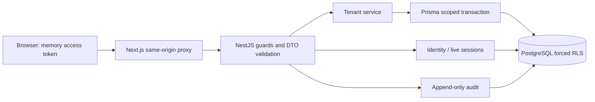

# Foundation architecture and validation

The source ADRs remain the product decisions. This note records implementation detail and limitations, not product/legal sign-off.

## Tenancy and access

School profile and membership rows carry `tenant_id`; audit entries can carry a tenant or represent global identity activity. A global platform identity is not a school-content access grant. Users and sessions are global. Membership discovery sets only the authenticated user ID, allowing that user's membership rows, then reads each authorised school in its own scoped transaction. Other domain queries must include tenant predicates.

Tenant context is set with parameterized `SELECT set_config('app.current_tenant_id', tenant, true)` in the same transaction as every institutional query. PostgreSQL does not support bind parameters in the ADR's illustrative `SET ... = $1`; `set_config` is its safe transaction-local equivalent. This prevents context leakage through a connection pool. Forced RLS is tested with a non-owner, non-superuser application role; missing context returns no rows. Status/membership/session checks run on each request.

`AuthGuard` validates issuer, audience, algorithm, expiry, session version and active context. `PermissionGuard` denies routes without explicit permission metadata. School ID routes also compare the requested object to the active school. Future class/subject objects are not exposed until their assignment policies exist. Roles such as guardian and reviewer have no implicit extra rights.

## Authentication

Bcrypt cost 12, 15-minute JWTs, random 48-byte rotating refresh secrets with SHA-256 storage and fixed seven-day session lifetime. Cookies are httpOnly/Strict and Secure in production. Rotation increments session version and stores spent hashes until expiry; reuse revokes the entire session. Context switching changes the live session version, immediately invalidating previous JWTs. TOTP secrets use AES-256-GCM, one-time time-step checks and five-minute purpose-bound enrollment challenges. A live session records whether MFA was performed, preventing later privileged role grants from silently upgrading a password-only session.

Global guards deny unauthenticated/unauthorised requests before controllers. Framework audit interception records completed/failed controller mutations and authenticated reads with correlation IDs, never request bodies. Explicit domain audit events are atomic with their changes. MFA verification consumes its time step before enabling MFA/login, failing closed if a subsequent operation fails. Enrollment uses the password and a short-lived encrypted-secret-bound challenge; identity recovery requires a separate approved design.

## Prisma technical validation (BL-004A)

Pinned Prisma 6.19.3 runs an engine-free JavaScript client and bundled WASM migration engine. No checksum bypass or unverified binary mirror is used. Two adapter-pg 6 compatibility issues were observed and isolated in `scripts/migration-adapter.ts` (wired by `prisma.config.ts`):

1. WASM catalog queries project PostgreSQL `name` columns, unsupported by adapter-pg 6. Only the two known catalog projections are cast to `text`.
2. adapter-pg 6 splits SQL at every semicolon, breaking PL/pgSQL. The migration adapter submits a whole script over `pg` inside BEGIN/COMMIT, with rollback on error.

This is an explicitly enabled Prisma experimental migration adapter, pinned and tested; revalidate before upgrading. The API uses the ordinary client adapter and never the migration adapter. Prisma schema is authoritative for models; SQL migrations additionally express policies, grants and triggers that Prisma cannot model. Generation, initial migration and no-op redeployment are validated. Integration tests exercise concurrent RLS transactions, missing-context reads, cross-tenant writes and rollback recovery.

The full ADR-002 go/no-go **is not signed off**: weighted grade aggregation under the future grading model and live lock/load characterization require that model and a representative pilot dataset. Do not infer these from foundational identity queries. Prisma migrations are forward-only by default; recovery uses tested transaction rollback and database restore, not an invented automatic down migration.

## Infrastructure boundaries

Local PostgreSQL is not encrypted production hosting. Production requires approved regional infrastructure, secret manager, TLS termination, separate migration credential, encrypted backups/storage, observability, restore drill, legal/security review and costs approval. Redis, BullMQ, object storage and the PDF engine are later milestones; no dummy paid/cloud services are provisioned.

## Dependency compatibility

NestJS 11 is retained for CommonJS/Jest interoperability. Root overrides pin patched multer 2.5, js-yaml 5.5 and deepmerge-ts 8.0.2; the complete API, migration and browser suites run against those versions. The initial workspace lock retained old nested versions, so the lock was regenerated from a clean install and runtime audit rechecked. npm 11 can report these workspace transitive overrides as invalid against the upstream exact version pins even though it installs the override; validate the installed versions, runtime audit and clean `npm ci` rather than discarding the security fixes. Revisit on a reviewed NestJS/Prisma upgrade.
